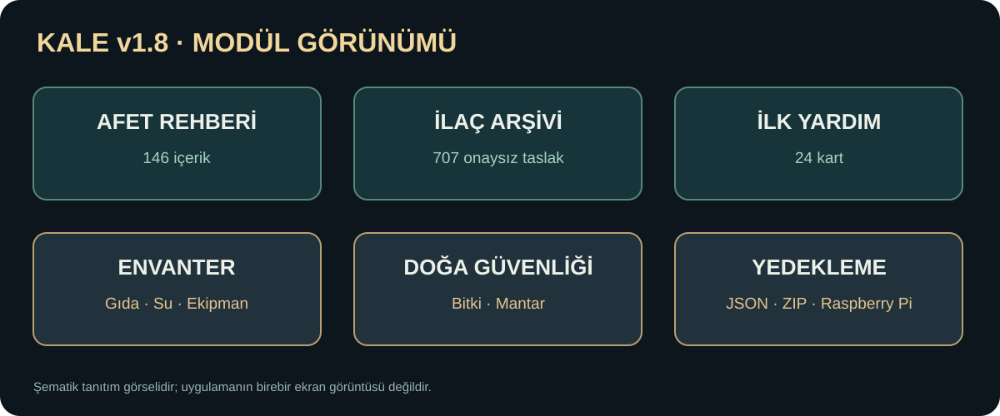
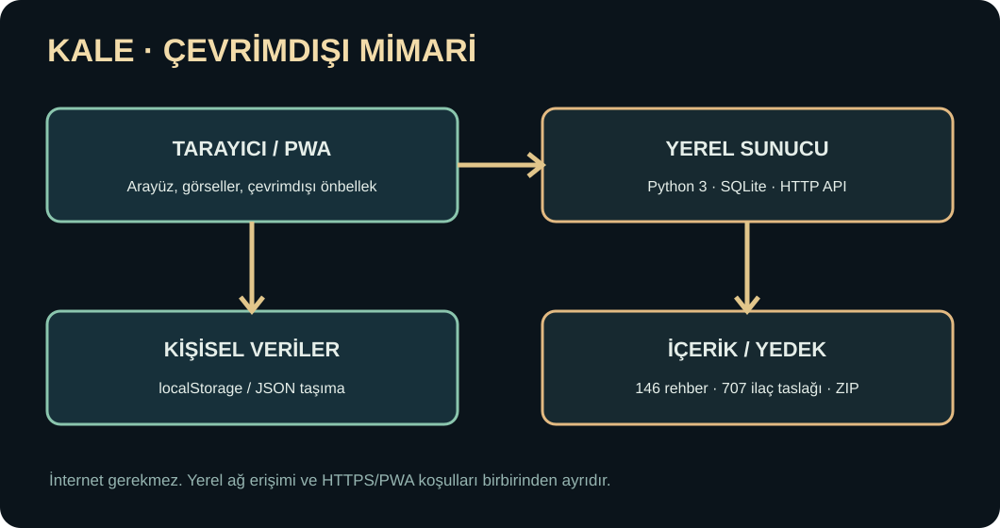

  

<h1 align="center">KALE — Offline Afet ve Yaşam Bilgi Sistemi</h1>

<strong>Python 3 · SQLite · PWA · Raspberry Pi · Türkçe · Çevrimdışı öncelikli</strong>

> **Yayın durumu (4 Kasım 2026):** Bu depoda şu anda **kurulum belgeleri ve görsel tanıtım var**. **KALE v1.8'in tam kaynak dosyaları ve veritabanı henüz bu GitHub deposuna aktarılmış değil.** Aşağıdaki kurulum komutları, tam kaynak paketi yüklendikten sonra çalışacaktır. Projenin durumunu gerçekte olduğundan ileri göstermemek için bu uyarı tutulmaktadır.

KALE (**Kapsamlı Afet ve Yaşam Envanteri**), internet bağlantısı olmasa da yerel sunucuda çalışabilen Türkçe bir afet hazırlığı ve bilgi merkezidir. Uygulama kişisel stok takibi, barınma ve su güvenliği, hazırlık planı, doğa farkındalığı, harita ve ilk yardım rehberlerini bir araya getirir.

## Özellikler — KALE v1.8

| Bölüm | Kapsam |
|---|---|
| Afet ansiklopedisi | 146 temel Türkçe rehber, arama ve kategori |
| Görselli rehberler | Barınak, su, gıda, enerji, kış ve saha kılavuzları |
| İlk yardım | 24 kaynak bağlantılı, uzman incelemesi bekleyen konu kartı |
| İlaç arşivi | 707 **klinik onayı olmayan** Türkçe taslak kaydı |
| Doğa güvenliği | Zehirli bitki ve mantar farkındalığı |
| Envanter | Gıda, su, ilaç, ekipman, TETT/SKT ve miktar takibi |
| Aile afet planı | 72 saat, kontrol listesi, su hesabı |
| Offline harita | Yerel özet coğrafya, koordinatlar ve isteğe bağlı raster MBTiles |
| Cihazlar arası aktarım | Yerel JSON dışa/içe aktarma; otomatik senkronizasyon değil |
| Yedekleme | SHA-256 kontrollü ZIP, geri yükleme doğrulaması, systemd timer |
| Raspberry Pi | Raspberry Pi OS/Debian için kurulum betiği |

## Görseller

**Mimari**

**Modüller**

> Buradaki SVG dosyaları **şematik tanıtım görselleridir**; uygulamanın gerçek ekran görüntüsü olarak sunulmaz. Gerçek ekran görüntüleri tam kaynak yayınıyla birlikte eklenecek.

## Kurulum — tam kaynak yayınından sonra

**Ubuntu / Debian / Raspberry Pi OS**

\`\`\`bash
sudo apt update
sudo apt install -y git python3
git clone https://github.com/nord-riot/KALE.git
cd KALE
python3 server.py --selftest
KALE_HOST=127.0.0.1 KALE_PORT=8090 python3 server.py
\`\`\`

Tarayıcı: [http://127.0.0.1:8090/](http://127.0.0.1:8090/)

**Docker**

\`\`\`bash
docker compose up -d --build
\`\`\`

**Raspberry Pi — systemd servis kurulumu**

\`\`\`bash
sh deploy/install-pi.sh --dry-run
sudo sh deploy/install-pi.sh
sudo systemctl status kale.service
sudo systemctl status kale-backup.timer
\`\`\`

> Pi kurulumunun gerçek donanım testi henüz yapılmadı. Betik \`/opt/kale\` zaten varsa kurulum yapmayı reddeder.

Tam adımlar: **[Kurulum kılavuzu](docs/INSTALL.md)** · **[Güvenlik ve sınırlamalar](docs/SECURITY.md)**

## Testler — tam kaynak yayınından sonra

\`\`\`bash
python3 server.py --selftest
python3 -m unittest discover -s tests -q
python3 tools/offline_audit.py
\`\`\`

v1.8 kaynak paketinin hazırlık aşamasında **95 Python otomatik testi** başarılıydı; GitHub deposunda bağımsız CI testi ve gerçek Raspberry Pi saha testi henüz tamamlanmadı.

## Güvenlik uyarısı

**KALE, tıbbi teşhis, reçeteleme veya profesyonel acil müdahale sistemi değildir.** İlaç ve ilk yardım taslaklarının klinik uzman kontrolü tamamlanmamıştır. Bitki/mantar kayıtları güvenli tüketim kararı verdirmez. Acil durumda **112**'yi aramayı geciktirmeyin. Özel JSON yedekleri, doktor inceleme verilerini ve konum bilgilerini herkese açık repoya yüklemeyin.

## Lisans ve katkı

Kaynak paketinde lisans belgesi bulunur; üçüncü taraf içerik ve veri kaynaklarının koşulları ayrıca değerlendirilmelidir. Saha, içerik ve donanım testleri tamamlanmadan gerçek acil durumlarda tek bilgi kaynağı olarak kullanılmamalıdır.

---

**Proje:** [github.com/nord-riot/KALE](https://github.com/nord-riot/KALE) · **Sürüm hedefi:** v1.8
