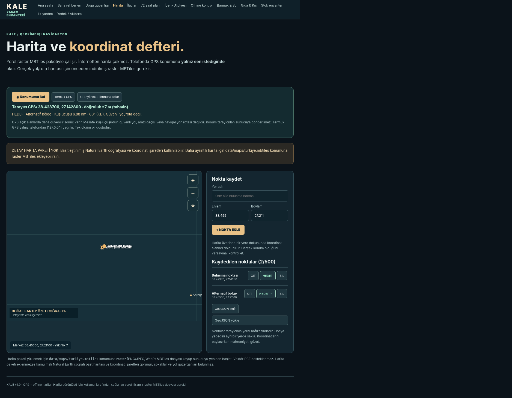
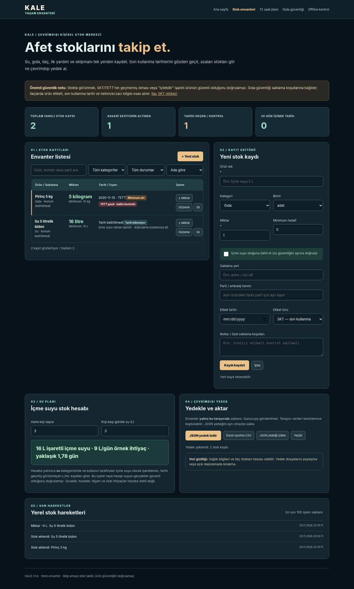
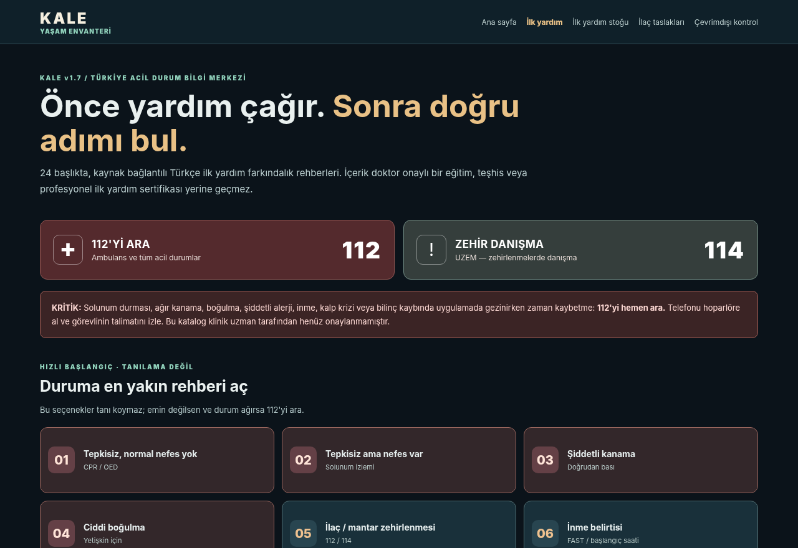
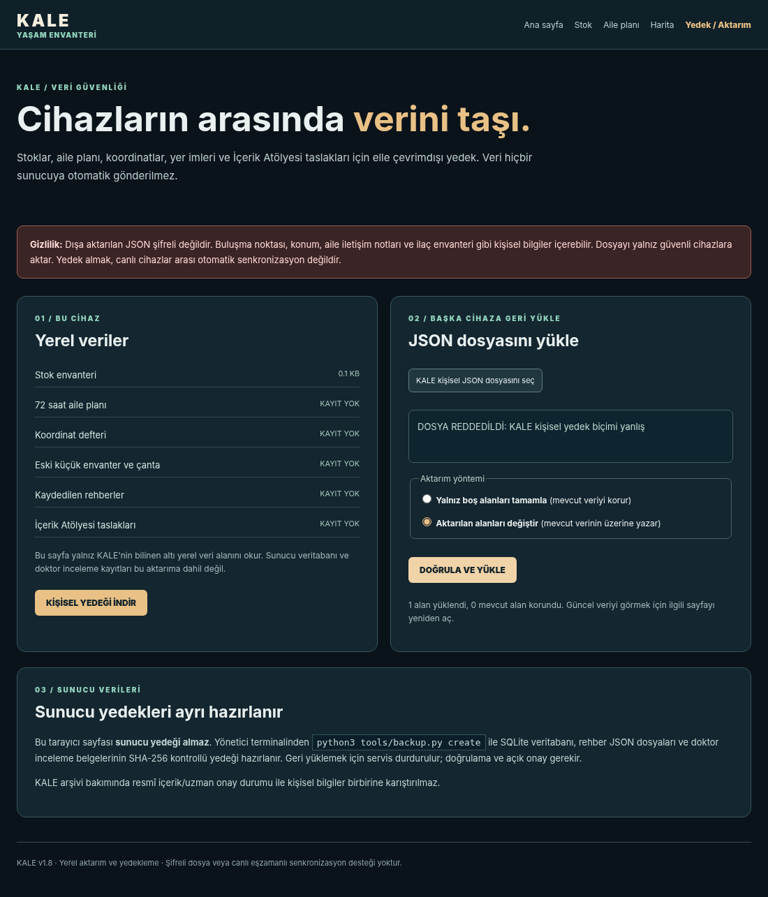

# KALE v2.1 — Türkiye Sokak Haritası + Offline Rota + Wi-Fi Sohbet

**Durum:** KALE'nin kaynak kodu, 146 rehber, 707 klinik onaysız ilaç kaydı,
özgün SVG şemalar, iki **Natural Earth ülke özeti haritası** ve Wi-Fi sohbeti bu
pakettedir. **Türkiye'nin ~570 MB gerçek sokak haritası ile ~232 MiB rota
bölgeleri internet erişimi olmadığı için pakete gömülmemiştir.** Yalnız ilk
kurulumda `tools/turkiye_full.py` komutuyla **resmî sağlayıcılardan** indirilir.
Bu işlemden sonra temel harita ve rota KALE sunucusunda internetsiz çalışabilir.

### GitHub'dan kurulum — Android / Termux

KALE v2.1 artık doğrudan **[GitHub ana dalından](https://github.com/nord-riot/KALE)** kurulacak şekilde hazırlanmıştır. Kullanıcılar aynı Wi-Fi ağına bağlanıp cihazın LAN IP'si ile sohbet ve bilgi merkezine erişebilir. Android'de root olmadan başka telefonların `localhost` adresi **kurucu telefonu göstermez**; `http://TELEFON_IP:8090` gerekir.

```bash
pkg update
pkg install -y git python unzip openjdk-17
git clone https://github.com/nord-riot/KALE.git
cd KALE
bash deploy/install-termux.sh install
# Türkiye'nin ayrıntılı haritasını ve rota dosyalarını internet varken indir:
python3 tools/turkiye_full.py all
~/bin/kale
```

- Kurucu telefonda: `http://127.0.0.1:8090`
- Aynı Wi-Fi'daki diğer telefonlarda: `http://TELEFON_IP:8090`
- Sohbet: `/sohbet.html`; online kişiler ve isimle giriş; mesajlar **RAM'de** tutulur, yeniden başlatılınca silinir.
- GPS için tarayıcı güvenli bağlam (localhost/HTTPS) gerekir; diğer cihazlarda düz HTTP kullanılırsa GPS izinleri çalışmayabilir.
- **Önemli:** `data/maps/turkiye.mbtiles` ve `data/maps/ege.mbtiles` küçük Natural Earth **örnek/özet haritalardır**; şehir-sokak detayını içermez. Gerçek Türkiye vektör MBTiles ve BRouter RD5 verileri **GitHub'da yoktur**; kurulum aracı internet varken indirir.
- KALE Wi-Fi sohbeti güvenilir yerel ağ içindir. Kimlik doğrulaması/şifreleme yoktur; internete açık port yönlendirmesi yapma.

### Ekran görüntüleri

**Android GPS ve harita arayüzü (v1.9):**



**Stok, ilk yardım ve veri aktarımı:**





### Telefona 3 adımda

1. Termux (F-Droid) kur, ZIP'i `Downloads` konumuna kopyala.
2. Termux içinde:

```bash
pkg update
pkg install -y python unzip openjdk-17
termux-setup-storage
cd ~
unzip ~/storage/downloads/KALE-Server-v2.1-Turkiye-Rota-WiFi.zip
cd KALE-v2.1
bash deploy/install-termux.sh install
python3 tools/turkiye_full.py all
```

3. **İlk veri indirmesi tamamlanınca** `~/bin/kale` ile sistemi başlat. Kurucu
telefon `http://127.0.0.1:8090`; aynı Wi-Fi'daki kişiler
`http://TELEFON_IP:8090/` adresinden girer.

- **Sohbet:** `/sohbet.html` · İsimle giriş, çevrimiçi liste, RAM'de mesaj geçmişi.
- **Bağlan:** `/baglan.html` · LAN IP ve isteğe bağlı QR.
- **Sokak haritası ve rota:** `/harita.html` veya `/rota.html` · Yerel Shortbread
  PBF vektör karoları, BRouter ile yürüyüş/bisiklet/araç rotası.
- **Veri denetimi:** `python3 tools/turkiye_full.py check`

**Önemli:** Bu ZIP'deki rota API kodu ve harita görüntüleyicisi simüle veriyle
birim/Chromium testlerinden geçti. **Gerçek 570 MB Türkiye Shortbread verisi,
BRouter Java motoru ve Android telefonla uçtan uca rota testi yapılmadı.**
Sahada güvenli yol garantisi yoktur: kapalı yollar, enkaz, sel/yangın veya
devam eden riskler offline OSM'de güncel olmayabilir. KALE'yi acil durumda tek
karar kaynağı olarak kullanma. Klinik taslaklar doktor onayı bekliyor.

**Tam kılavuz:** [Türkiye Offline Navigasyon](docs/TURKIYE_OFFLINE_NAVIGASYON.md).

---

# KALE v1.9 — Android/Termux GPS + Offline Harita

**v1.9 yenilikleri:** Android/Termux için tek komutluk yerel başlatıcı (`deploy/install-termux.sh`), tarayıcı tek-seferlik konum ölçümü, isteğe bağlı Termux:API GNSS kaynağı, hedefe kuş uçuşu mesafe/yön, raster MBTiles doğrulama ve yedekli harita yükleme (`tools/map_pack.py`). Veri arşivi **146 temel rehber ve 707 ilaç kaydı** korunur. Offline harita için ayrıca **lisanslı detay karo paketi** gerekir; yerleşik veri yalnız özet ülke haritasıdır. GPS ve gerçek Android saha testi henüz yapılmadı.

**[Android kurulum kılavuzu](docs/ANDROID-TERMUX.md)** · **[Türkiye offline harita paketi](docs/MAPS-OFFLINE.md)** · **[Kiwix / offline kitap](docs/KIWIX-ANDROID.md)**

Telefonda başlangıç:

```bash
pkg update && pkg install -y python git
# İlk kurulumda internet gerekir
git clone https://github.com/nord-riot/KALE.git
cd KALE
bash deploy/install-termux.sh install
~/bin/kale
```

**Not:** V2.1 GitHub kurulum adımları bu belgenin başındadır. ZIP ile kurulum da desteklenir. Termux:API gerekiyorsa aynı kaynaktan uygulama + `pkg install termux-api` kurulmalı. Temel Termux kurulumunda proot Ubuntu, root ve yapay zekâ gerekmez. Telefon haritası `http://127.0.0.1:8090/harita.html` adresinde.

---

# KALE v1.8 — Yedekleme, Veri Aktarımı ve Raspberry Pi

**K.A.L.E. — Kapsamlı Afet ve Yaşam Envanteri** · Sürüm **1.8.0** · 3 Kasım 2026. Python standart kütüphanesiyle çalışan, yerel bilgi sunucusu. Bu sürümde **146 temel rehber, 707 doğrulanmamış ilaç taslağı, 24 ilk yardım kartı**, önceki görselli saha / doğa / barınak / su / stok ekranları korunmuştur.

## v1.8 ile gelenler

- **/aktarim.html:** Kişisel stok, aile planı, koordinat, eski envanter, kaydedilmiş rehber ve editör taslaklarını **tek JSON dosyasına** kaydet / diğer cihazda geri yükle. **İçe aktarma seçeneği:** `Yalnız eksikleri tamamla` veya `Dosyadaki alanların üzerine yaz`. Alanlar şema/sayı/boyut bakımından kontrol edilir. Her iki cihazın tarayıcısı da KALE v1.8 olmalıdır. **Bu gerçek zamanlı/arka planda eşitleme değildir.** Kullanıcının dosyayı taşıması gerekir.
- **tools/backup.py:** Sunucuya ait SQLite DB, ham rehber/ilaç kaynak JSON/PSV dosyaları ve `review/` hekim inceleme dosyalarını **SHA-256 manifestli ZIP** içinde yedekle, doğrula ve açık onayla geri yükle. **MBTiles harita karoları** ve tarayıcı `localStorage` verileri sunucu ZIP'inde **yoktur**.
- **deploy/kale-backup.timer:** Raspberry Pi / Debian / Ubuntu systemd üzerinde **her gün saat 03:15**, 0–10 dakika rastgele gecikmeyle; ilk seferde kaçırılmış işleri telafi edebilir (`Persistent=true`). Sadece son 14 otomatik yedeği tutar (dizin altındaki KALE isimli yedeklerde). **Sunucu kurulu/çalışır hale getirilmedikçe otomatik görev çalışmaz.**
- **deploy/install-pi.sh:** Uygulama ve zamanlayıcıyı kurmak için Raspberry Pi OS / Debian / Ubuntu üzerinde **kurulum betiği**. Kurulu `/opt/kale` dosyalarını asla kendiliğinden üzerine yazmaz.
- **PWA v1.8:** Yeni aktarım ekranı ve JS/CSS dosyaları önbelleğe alınır. İnternet kesikken tarayıcıda kullanım, önceden başarılı önbellekleme ve güvenli `localhost` / HTTPS bağlamı gerektirir.

### Masaüstü / sunucu kurulumu

```bash
unzip KALE-Server-v1.8-Yedekleme-Pi.zip
cd KALE-v1.8
python3 server.py --selftest
python3 -m unittest discover -s tests -q
python3 tools/offline_audit.py
KALE_HOST=127.0.0.1 KALE_PORT=8090 python3 server.py
```

Arayüz: `http://127.0.0.1:8090/` • Veri aktarımı: `http://127.0.0.1:8090/aktarim.html` • İlaçlar: `/ilaclar.html` • İlk yardım: `/ilk-yardim.html` • Stok: `/envanter.html`.

### Sunucu yedeği (internet gerektirmez)

```bash
python3 tools/backup.py create
python3 tools/backup.py create --output-dir /güvenli/yedek/konumu --keep 14
python3 tools/backup.py verify /güvenli/yedek/konumu/KALE-SERVER-BACKUP-XXXX.zip
```

Varsayılan `backups/` klasörü; dosyalar kullanıcıya özel **0600**, `backups/` dizini **0700** oluşturulur. Yedek dosyası **şifrelenmez**: doktor notları ve özel içerik taşıyabilir. Güvenli ve mümkünse ayrı bir diske kopyala. USB/disk kaybına karşı ayrıca şifreli depolama kullan. Yedek alındıktan sonra `verify` çalıştır ve mümkünse farklı cihazda test geri yüklemesi yap.

### Sunucu geri yükleme

Önce **KALE servisini durdur**. Seçtiğin dosyayı terminalde `verify` ile doğrula. Geri yükleme varsayılan olarak ön inceleme yapar; dosya yazmaz:

```bash
python3 tools/backup.py restore /yedek/KALE-SERVER-BACKUP-XXXX.zip
```

Gerçek geri yükleme (servis durmuşken):

```bash
python3 tools/backup.py restore /yedek/KALE-SERVER-BACKUP-XXXX.zip --apply --confirm GERI_YUKLE
python3 server.py --selftest
```

Arşiv `manifest.json` SHA-256 ve SQLite bütünlük kontrolünden geçmedikçe yazılmaz. Yükleme başlamadan mevcut sunucu verilerinin **güvenlik yedeği** alınır. Birçok dosya sırayla yenilendiği için iş **tek atomik veritabanı işlemi değildir**: geri yükleme yarıda kesilirse otomatik oluşturulmuş güvenlik yedeğinden tekrar yükle. `doctor_reviews.sqlite3` ve özel dosyalar gizli saklanmalı.

### Raspberry Pi OS / Debian / Ubuntu kurulumu

```bash
# Önce zip'i çıkarıp KALE-v1.8 klasörüne gir.
sh deploy/install-pi.sh --dry-run
sudo sh deploy/install-pi.sh
sudo systemctl status kale.service
sudo systemctl list-timers kale-backup.timer
```

Kurulum `/opt/kale` altına kopya oluşturur, giriş yapamayan `kale` sistem kullanıcısı tanımlar, `kale.service` ile **sadece 127.0.0.1:8090** üzerinde servis açar; günlük yedekler `/var/lib/kale/backups` konumundadır. Sunucuya aynı Wi-Fi üzerinden erişmek için `/etc/default/kale` dosyasında `KALE_HOST=0.0.0.0` ayarlayıp `sudo systemctl restart kale` çalıştır; **güvenlik duvarı ile sadece güvenilir yerel ağa sınırla**. İnternete kimlik doğrulama, TLS ve erişim kontrolleri olmadan yayınlama.

**Kritik:** Pi sisteminde önce var olan `/opt/kale` dizini varsa betik kurulum yapmayı reddeder. Yükseltmeden önce mevcut dosyaların ve tarayıcı JSON bilgilerinin yedeğini al, eski servisi durdur, yeni sürümü ayrı klasörde hazırla; orijinal kaynaklarla yerel değişiklikleri karşılaştır. Script Raspberry Pi donanımında henüz denenmedi; önce boş/test cihazında uygula.

### Cihazlar arası veri taşıma / veri mahremiyeti

1. Eski cihazdan KALE `/aktarim.html` sayfasına girip **kişisel yedeği indir**.
2. JSON dosyasını yerel/USB yöntemle diğer cihaza aktar.
3. Diğer cihazda aynı sayfadan dosyayı aç. Dosyadaki veri alanları ve aktarım modu ekranda görünür.
4. Mevcut veriyi korumak için **yalnız boş alanları tamamla** seçeneğini kullan; üzerine yazmak istiyorsan ayrı bir yedek al ve onay ver.
5. İlgili sayfaları yeniden aç, verileri kontrol et. Aynı kaynak iki cihazda değiştiyse **otomatik çakışma çözümü yoktur**; son durumu kullanıcı belirler.

**Güvenlik:** Yalnız 6 bilinen yerel KALE kayıt türü taşınır; dosya boyutu ve veri yapısı kontrol edilir. JSON **şifreli veya dijital imzalı değildir**. İçindeki konum/iletişim bilgileri hassas olabilir. Tarayıcı verileri silinirse saklanan kopyalar kaybolur; fiziksel yedek tut. Sunucu SQLite/klinik inceleme verileri bu aktarım ekranına dahil değildir.

### Test ve kapsam sınırları

- **95 Python otomatik testi**, bağımsız **Chromium JSON içe/dışa aktarma smoke testi**, `server.py --selftest` ve `offline_audit.py` testi.
- Güvenlik kontrolleri: dizin dışı dosya yolu/yanlış SHA-256 arşivi reddi, geri yüklemede açık onay, mevcut sunucu verisi güvenlik yedeği, ilaç ve rehber sayısı kontrolü.
- **Gerçek Raspberry Pi OS kurulumu, gerçek cihazlar arası USB aktarımı, elektrik kesintisi ve tam ağ kesintisi testi henüz gerçekleştirilmedi.** Bunlar saha kabul testidir.
- İlaçlar **doktor/eczacı onayı bekleyen taslaktır**. İlk yardım kartları da uzman incelemesi gerektirir. Acilde 112'yi aramayı geciktirme.

---

## Önceki modüller ve tarihsel geliştirmeler

## KALE v1.7 — İlk Yardım ve Afet Bilgi Merkezi

**K.A.L.E. — Kapsamlı Afet ve Yaşam Envanteri**  
Sürüm **1.7.0** · Tarih: 3 Kasım 2026 · Python 3 tabanlı, yerel/offline bilgi merkezi.

## KALE v1.7: İlk Yardım ve Acil Durum Merkezi

**Yeni adres:** `/ilk-yardim.html` — Türkiye için **112** Acil Çağrı ve **114** UZEM doğrudan arama bağlantılı, **24 Türkçe konu kartı**, **24 özgün ve şematik SVG başlığı**, arama, kategori/öncelik filtresi, hızlı kart seçimi ve yazdırma.

- Hayati acil: yetişkinde CPR, OED/AED, ağır kanama, derlenme pozisyonu, boğulma, anafilaksi, inme, göğüs ağrısı.
- Diğer durumlar: nöbet, ağır hipoglisemi, astım, sudan kurtarma, kimyasal/ilaç ve mantar/bitki zehirlenmesi, CO, yılan ısırığı, yanık, kimyasal göz teması, elektrik çarpması, kırık, baş/boyun yaralanması, burun kanaması, sıcak çarpması, hipotermi.
- Her kartın en az bir HTTPS kaynak URL'si, belirtiler, ilk adımlar, kaçınılacak hatalar ve hangi durumda 112 aranacağı alanı var.
- Kayıtlar **onaylanmamış editoryal taslak** olarak belirgin işaretli. Bunlar profesyonel ilk yardım eğitimi, teşhis veya tedavi yönergesi yerine geçmez. Çocuk/bebek/hamile uygulamaları farklıdır; bunlar için yetişkin tekniklerini kullanmayın.
- Kartlar yerel `web/assets/first-aid.json` verisinden yüklenir. İnternet gerektirmeyen mini sunucuda kullanılabilir; PWA servis çalışanının önceden kurulup önbelleğin doldurulmuş olması koşuluyla tarayıcıda da offline okunabilir. **Gerçek Raspberry Pi / gerçek bağlantı kesintisi testi henüz yapılmadı.**
- Klinik uzman inceleme görevi: `review/ILK_YARDIM_KLINIK_INCELEME.md`. **Hiçbir kart bağımsız hekim onaylı kabul edilmemektedir.**

Test ve offline paket denetimi:

```bash
python3 server.py --selftest
python3 tools/offline_audit.py
python3 -m unittest discover -s tests -q
# Opsiyonel: Chromium ve Playwright varsa
python3 tests/manual_browser_firstaid_v17.py
```

Yeni modül `server.py` ve `/sw.js` statik dosya erişimine kayıtlıdır. İlaç ve afet veritabanı **değiştirilmemiştir**, 707 ilaç ve 146 ana rehber korunmuştur. Acil durumda **önce 112'yi ara ve gerçek görevlilerin talimatlarına uy**.

---

## Önceki sürümden korunan stok envanteri (`/envanter.html`)

Bu sürümde **gıda, içme suyu, ilaç, ilk yardım, enerji, ekipman, hijyen ve diğer** stoklar için çalışan kişisel envanter modülü eklendi.

- Ürün adı, kategori, miktar, birim (`L`, `mL`, `kg`, `g`, `adet`, `paket`, `kutu`), minimum stok, saklama yeri, parti ve notları kaydet.
- Aynı ürünün farklı ambalajlarını veya son kullanma tarihlerini **farklı kayıtlar** olarak tut.
- **SKT** (son kullanma tarihi), **TETT** (tavsiye edilen tüketim tarihi) ve tarihi bilinmiyor durumlarını ayrı izle.
- Tarihi geçmiş ve 30 gün içinde tarihi yaklaşan kayıtları; minimumun altına düşen stokları filtrele.
- **± Miktar** ile tüketim/ekleme hareketlerini kaydet; son 100 yerel hareketi görüntüle.
- **İçme suyu stok hesabı:** Sadece `Su` kategorisinde kullanıcı tarafından işaretlenmiş ve tarihi geçmiş görünmeyen `L`/`mL` stokları topla. Kişi sayısı × kişi başı günlük litre girdisi ile örnek gün hesabı yap. **Bu hesap suyun içilebilirliğinin doğrulandığı anlamına gelmez.**
- **JSON yedekleme / geri yükleme**, Excel uyumlu **CSV dışa aktarma**, yazdırma.
- Yerel yedek aktarımında şema, kategori, tarih, sayı, kayıt ID benzersizliği ve 500 kayıt sınırı kontrolü; hatalı dosyalar reddedilir. CSV hücrelerinde formül enjeksiyonuna karşı koruma vardır.

### Gizlilik ve dayanıklılık

**Kişisel stoklar tamamen kullanıcının tarayıcısının `localStorage` alanındadır.** KALE sunucusuna POST atılmaz, ilaç/stok bilgileri otomatik olarak başka cihaza aktarılmaz. Tarayıcı verileri silinirse stoklar kaybolabilir; JSON dosyasını düzenli olarak harici, güvenli bir diskte saklayın. Aynı verinin farklı cihazlar arasında otomatik senkronizasyonu henüz yoktur. Tarayıcı özel modunda veya veri saklamanın kapalı olduğu cihazlarda kalıcılık garanti edilmez.

**Önemli:** Tarihin geçmesi veya geçmemesi tek başına gıdanın güvenli/güvensiz olduğunun kanıtı değildir; saklama/ambalaj/soğuk zincir koşulları da önemlidir. Özellikle bebek mamasında üretici `use-by` tarihlerine uyulmalıdır. **Son kullanma tarihi geçmiş, uygun saklanmamış veya kimliği belirsiz ilaçlar kullanılmamalıdır.** KALE envanteri teşhis, ilaç güvenliği, doz veya klinik karar vermez.

Referanslar: [FDA ilaç SKT](https://www.fda.gov/drugs/pharmaceutical-quality-resources/expiration-dates-questions-and-answers), [FDA gıda tarih etiketleri](https://www.fda.gov/food/consumers/how-cut-food-waste-and-maintain-food-safety), [FoodSafety.gov acil stok](https://www.foodsafety.gov/keep-food-safe/food-safety-in-disaster-or-emergency).

## Kurulum

```bash
unzip KALE-Server-v1.8-Yedekleme-Pi.zip
cd KALE-v1.8
python3 server.py --selftest
python3 -m unittest discover -s tests -q
python3 tools/offline_audit.py
KALE_HOST=127.0.0.1 KALE_PORT=8090 python3 server.py
```

- Ana ekran: `http://127.0.0.1:8090/`
- **İlk yardım merkezi:** `http://127.0.0.1:8090/ilk-yardim.html`
- **Stok envanteri:** `http://127.0.0.1:8090/envanter.html`
- Hazırlık planı: `http://127.0.0.1:8090/plan.html`
- Offline kontrolü: `http://127.0.0.1:8090/offline.html`
- İlaç ansiklopedisi: `http://127.0.0.1:8090/ilaclar.html`

Güvenilir yerel ağda erişim için `KALE_HOST=0.0.0.0` kullanılabilir. Kimlik doğrulaması, HTTPS ve ağ erişim kısıtlaması olmadan sunucuyu internete açma. PWA önbelleği `localhost` veya HTTPS güvenli bağlam gerektirir; LAN'da sıradan HTTP sayfaları görüntülenebilir ama PWA çevrimdışılık garantisi yoktur.

### v1.6'dan yükseltme

1. Eski sunucuyu durdur. v1.7 paketini **ayrı klasöre** aç. Önce mevcut `data/kale.db`, `data/content.json`, `data/doctor_reviews.sqlite3`, MBTiles, özelleştirilmiş rehberler ve tarayıcıdaki plan/harita verilerinin yedeğini al.
2. Yeni paket eski kullanıcı dosyalarını otomatik güncellemez veya sunucudaki kişisel verileri taşımaz; özelleştirmeleri dikkatle karşılaştır.
3. `/offline.html` bölümünde PWA önbelleğini yenile. Mobil/gerçek ağ kesintisi testi ve Raspberry Pi testi ayrı gereklidir.

## Test / doğrulama

- **79 otomatik test** başarılı (önceki 73 + 6 yeni Python / Node doğrulama testi). Sunucuyu çalıştırmak için Node gerekmez; JS testleri için Node isteğe bağlıdır.
- `tests/manual_browser_inventory_v16.py`: Chromium'da ürün ekleme, su hesabı, az stok, SKT/TETT, miktar ayarlama, filtreleme, JSON/CSV dışa aktarma, JSON geri yükleme ve hatalı yedek reddi test edildi. Yalnız test için Playwright + Chromium gerekir.
- `data/kale.db` içindeki **707 ilaç / 146 genel rehber** korunur. Tıbbi kayıtlar yine **doktor/eczacı onayı bekleyen editoryal taslaklardır**.
- Gerçek Raspberry Pi donanımında ve internet kesintisiyle PWA saha testi **henüz tamamlanmadı**.

---

## Önceki v1.5 modülleri (korundu)

## v1.5 yenilikleri

`/gida-enerji.html` adresinde **24 yeni, özgün SVG şemalı Türkçe rehber** bulunur:

| Kategori | Kart | Konular |
|---|---:|---|
| Gıda saklama | 6 | Buzdolabı, derin dondurucu, buz aküsü, kuru erzak, konserve, sel sonrası gıda |
| Güvenli pişirme | 6 | Kamp ocağı, mangal, gıda iç sıcaklığı, çapraz bulaşma, güvenli çözdürme, yangın |
| Enerji yönetimi | 6 | Powerbank envanteri, Wh hesabı, güneş paneli, şarj öncelikleri, lityum batarya, jeneratör |
| Kış güvenliği | 6 | Katmanlı giyim, ıslak giysi, hipotermi, donma, yaşlı/bebek riski, güvenli ısınma |

**Üç etkileşimli kontrol:**

1. **Elektrik kesintisinde gıda değerlendirmesi:** Buzdolabı / tam veya yarı dolu dondurucu, kaç saat elektrik olmadığı, kapağın durumu ve sıcaklık/ürün geçmişine göre uyarı. **Hiçbir koşulda otomatik tüketim onayı vermez.**
2. **Batarya çalışma süresi:** `Wh × verim(%) × (1 − rezerv(%)) / W` formülünden teorik saat/gün hesabı; kritik tıbbi cihazlara yönelik uygunluk/garanti oluşturmaz.
3. **Soğuk riski:** Titreme, bilinç değişikliği, uyuşmuş deri ve ıslak giysi gibi belirtilere dayalı acil uyarı. Tanı koymaz; ciddi durumda **112** yönlendirmesi sunar.

**Önemli referans değerleri** — buzdolabı kapalıyken yaklaşık 4 saat, tam dolu kapalı dondurucu 48 saat, yarı dolu 24 saat soğuk tutabilir. Bunlar bütün koşullarda güvenlik garantisi değildir. Kanatlı hayvan ve yeniden ısıtılan artan yemekler 74°C, kıyma 71°C; bütün kırmızı et kesimleri 63°C + 3 dakika dinlenme genel pişirme hedefleridir (gıda termometresiyle). **Bozulmuş gıdayı pişirerek kurtarmaya çalışma.** Karbonmonoksit renksiz ve kokusuzdur; mangal, kamp ocağı ve jeneratörü kapalı alanda kullanma.

### Korunan eski modüller

- **146** temel Türkçe afet rehberi ve **15** kategori.
- **707** Türkçe ilaç kaydı (**404 ilaç bazlı, 303 sınıf bazlı klinik inceleme bekleyen taslak**). Hiçbiri bağımsız hekim/eczacı onayından geçmiş sayılmaz.
- **28** önceki görselli saha kartı, **18** barınak/su kartı ve **24** yeni gıda/enerji/kış kartı: toplam **70 ayrı şemalı kart**.
- Doğa güvenliği: **28 zehirli bitki + 16 mantar uyarısı**; fotoğrafla teşhis ve yenilebilirlik onayı vermez.
- Barınak/Su risk kontrolleri, çevrimdışı coğrafi özet/koordinat defteri, 72 saat aile planı, İçerik Atölyesi, doktor inceleme CSV/Excel akışı ve kapalı API yazma politikası.

## Kurulum

Python 3 gereklidir; sunucu için ek Pip paketine ihtiyaç yoktur.

```bash
unzip KALE-Server-v1.8-Yedekleme-Pi.zip
cd KALE-v1.8
python3 server.py --selftest
python3 -m unittest discover -s tests -q
python3 tools/offline_audit.py
KALE_HOST=127.0.0.1 KALE_PORT=8090 python3 server.py
```

Ana ekran: `http://127.0.0.1:8090/`  
**Yeni modül:** `http://127.0.0.1:8090/gida-enerji.html`

Kontrollü yerel ağda diğer cihazların bağlanması için `KALE_HOST=0.0.0.0` kullanılabilir. İnternet üzerinde **kimlik doğrulaması, HTTPS ve ağ erişim kısıtlaması olmadan** yayınlama. PWA servis çalışanı yalnız `localhost` veya HTTPS gibi güvenli bağlamlarda kurulur. Uygulama sunucusu internetsiz yerel ağda çalışabilir; ilk PWA kurulumu/güncellemesi ve gerçek internet kesintisi testi ayrı gereklidir.

## v1.4 sürümünden yükseltme

1. Önce v1.4 sunucusunu durdur ve tam bir yedek al. v1.5'i **ayrı klasöre** aç.
2. Özelleştirilmiş verilerin varsa `data/doctor_reviews.sqlite3`, `data/maps/*.mbtiles` ve kullanıcıya özgü diğer dosyaları dikkatle karşılaştırarak taşı. `data/content.json` veya `data/kale.db` dosyasında önceki kullanıcı düzenlemelerini yeni dosyaların üzerine rastgele yazma; içerik değişikliklerini önce karşılaştır.
3. Tarayıcı localStorage içinde bulunan 72 saat planı, koordinat ve envanter gibi kişisel kayıtlar ZIP'e otomatik dahil değildir. Kullanıcı tarafında ayrıca yedeklenmelidir.
4. `/offline.html` sayfasında yeni **v1.7.0** önbelleğini kontrol et ve ağı gerçekten keserek yeni modülün çalıştığını dene.

## Testler ve sınırlamalar

- **79 otomatik test başarılı** (önceki 66 + 7 yeni), SQLite bütünlüğü, içerik/şema, resim, kritik uyarılar ve önbellek listesi kontrol edildi.
- `tests/manual_browser_food_v15.py` ile Chromium'da 24 görsel, 4 filtre, 3 risk arayüzü, detay penceresi ve JS hataları incelendi. Görsel test gerçek HTTP/PWA ağ kesintisi koşullarını simüle etmez.
- Yeni 24 kartın çizimleri **özgün şematik görsellerdir**, fotoğraflı uygulama talimatı ya da mühendislik projesi değildir.
- **Gerçek Raspberry Pi, fiziksel pişirme/barınma ve çevrimdışı cihaz/pil testleri yapılmadı.** Klinik ve saha güvenliği uzman doğrulaması gerekir.

## Başvuru kaynakları

- [FoodSafety.gov — Power Outage](https://www.foodsafety.gov/food-safety-charts/food-safety-during-power-outage)
- [FoodSafety.gov — Safe Minimum Internal Temperatures](https://www.foodsafety.gov/food-safety-charts/safe-minimum-internal-temperatures)
- [CDC — Emergency Food Safety](https://www.cdc.gov/food-safety/foods/keep-food-safe-after-emergency.html)
- [FDA — Safe Food Handling](https://www.fda.gov/food/buy-store-serve-safe-food/safe-food-handling)
- [CDC — Carbon Monoxide Poisoning](https://www.cdc.gov/carbon-monoxide/about/)
- [CDC — Preventing Hypothermia](https://www.cdc.gov/winter-weather/prevention/index.html)

Kaynak bağlantıları internetsizken açılmaz ve her bir kartın ayrıca uzman tarafından doğrulandığı anlamına gelmez. Yerel resmî afet/sağlık uyarıları her zaman önceliklidir.

---

## KALE v2.1 — Türkiye sokak haritası, gerçek offline rota ve Wi-Fi sohbeti

**Yeni kurulum kılavuzu:** [docs/TURKIYE_OFFLINE_NAVIGASYON.md](docs/TURKIYE_OFFLINE_NAVIGASYON.md)

- `harita.html` ve `rota.html`: Türkiye Shortbread **vektör** MBTiles desteği, sade OSM sokak çizimi.
- Gerçek yürüyüş, bisiklet ve araç rotaları için yerel BRouter (GeoJSON, `127.0.0.1:17777`), yol üzerinden çizgi ve mesafe/süre.
- `sohbet.html` ve `baglan.html`: Aynı Wi-Fi/hotspot üzerinde isimle giriş, bağlılar listesi, RAM'de geçici mesajlaşma ve bağlantı URL/QR (QR isteğe bağlı `qrcode` bağımlılığı).
- `python3 tools/turkiye_full.py all`: BBBike Türkiye sokak haritası, BRouter'ın **10** Türkiye bölgesi, BRouter Java paketi **internetten önceden** indirilip doğrulanır.
- Android: `bash deploy/install-termux.sh install` → `~/bin/kale`; rota motoru yüklüyse aynı başlatıcıyla çalışır.

**Kritik sınır:** Arşiv yaklaşık 2 MB'tır ve **570 MB harita + ~232 MiB rota dosyası ZIP içinde değildir**; indirme burada ağ erişimi olmadığı için uygulanamadı. Tam saha offline rotası ancak belirtilen veriler indirildikten ve gerçek Android telefonda test edildikten sonra onaylanabilir. Yolların açık/ güvenli olduğu varsayılmaz; canlı trafik/afet güncellemesi yoktur. 707 ilaç kaydı halen klinik uzman onayı beklemektedir.
